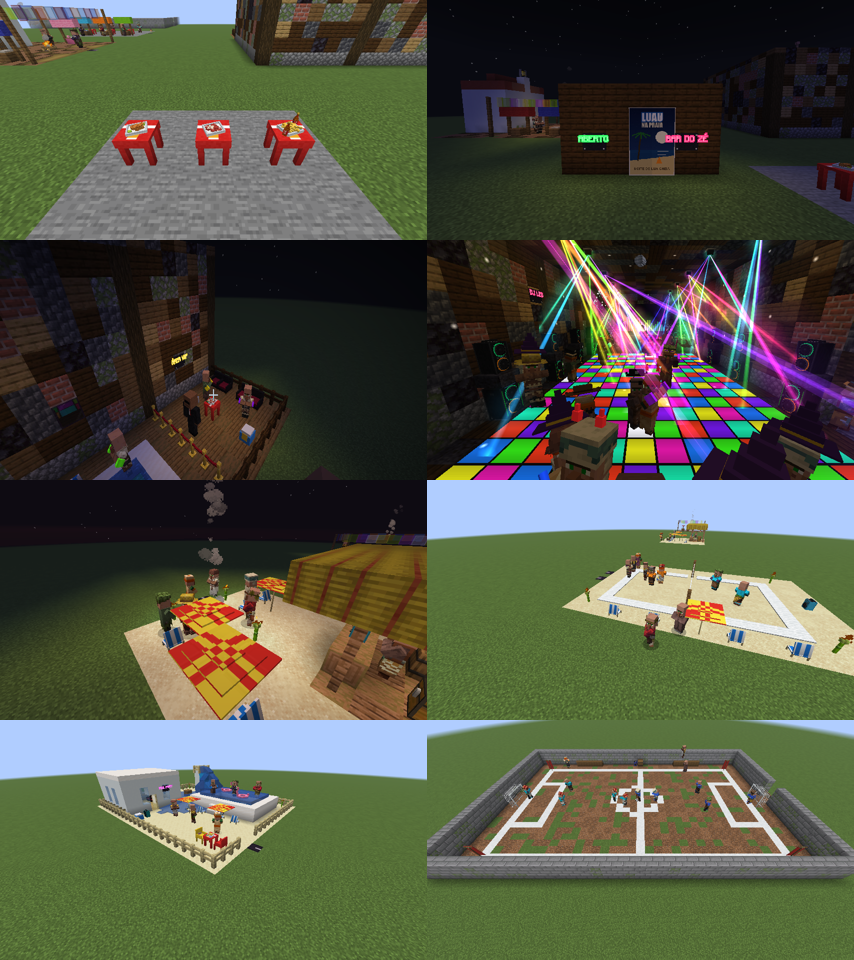
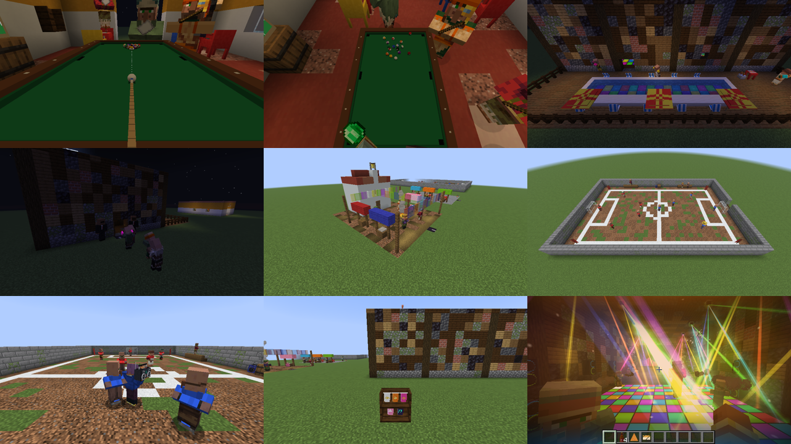
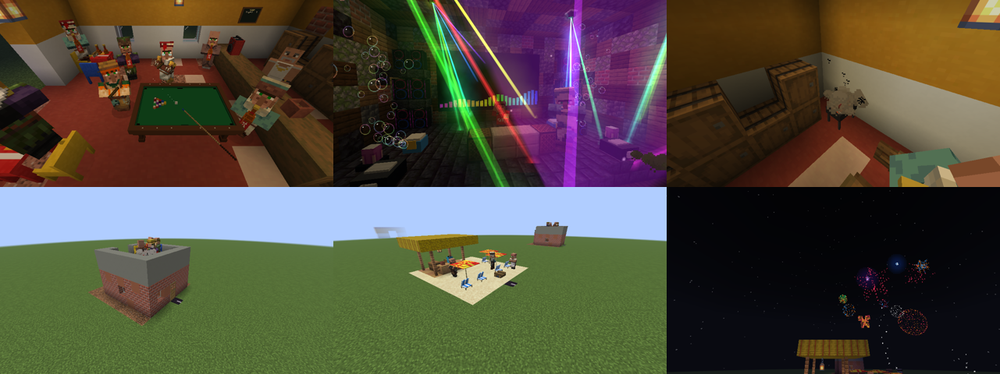

# Boombox — mod Fabric para Minecraft 26.3

Uma boombox que toca músicas para todo mundo por perto, sincronizadas em tempo real.

## Instalação
1. Instale o **Fabric Loader 0.19.5+** e o **Fabric API** para Minecraft 26.3.
2. Copie `build/libs/boombox-3.1.0.jar` para a pasta `mods` **do cliente de cada jogador e do servidor**.
3. Na primeira vez que alguém entra num mundo, o mod baixa sozinho (Windows) para `.minecraft/boombox/bin`:
   - `yt-dlp` (YouTube), `ffmpeg` (decodificar o áudio) e `deno` (o yt-dlp precisa dele para o YouTube).
   - No Linux/macOS o `ffmpeg` precisa estar instalado (`sudo apt install ffmpeg` / `brew install ffmpeg`).

## Como usar
- Receita: barra de ferro em cima, tábuas + jukebox + tábuas no meio, tábuas + redstone + tábuas embaixo
  (ou pegue no criativo, na aba própria **Boombox e Caixas de Som**).
- Clique com o botão direito na boombox para abrir o menu:
  - **Tocar**: cole um link (YouTube, SoundCloud, link direto de .mp3…) e toque. Se você digitar texto em vez de link, ele pesquisa.
  - **Pesquisar**: busca no YouTube e mostra os resultados; clique em um para tocar.
  - **Minhas músicas**: lista os arquivos em `.minecraft/boombox_musicas` (botão **Abrir pasta**).
    Ao tocar, o arquivo é enviado ao servidor (máx. 50 MB) e os outros jogadores o baixam automaticamente.
  - **Pausar / Continuar**: pausa para todo mundo e continua do mesmo ponto.
  - **Parar**.
  - **Volume** (0–100%): vale para todos que estão ouvindo essa boombox.
- O som é 3D: vem da boombox e diminui até sumir a ~48 blocos. Também segue o controle **Jukebox/Discos** das opções de som.

## Novidades da 3.9.0

- **Estádio em cada vila**: além do campo de várzea, as vilas novas ganham um estádio, com arquibancada em volta,
  refletores, placares, túnel e vestiário. São quatro estilos (Caldeirão, Arena, Alçapão e Estádio Municipal), e o
  nome sai da própria vila. No estádio a torcida é maior e fica na arquibancada.
- **Final da várzea no estádio**: quando o seu time chega na final da Copa da Várzea, a final vai para o estádio da
  vila. Uma seta na tela leva até lá, e o jogo começa quando você chegar.
- **Copa das Vilas**: quem ganha a Copa da Várzea se classifica. Entram os times das 8 vilas mais perto, em
  mata-mata (quartas, semifinal e final). O estádio de cada fase é sorteado entre os das vilas da copa, e a seta
  mostra o caminho. Quem ganha leva a Taça da Copa das Vilas. A tabela (tecla J) mostra o chaveamento.
- **Clássico contra a vila rival**: cada vila tem uma rival (a vila mais perto). No organizador, "Clássico" marca o
  jogo do time da sua vila contra o time da rival. A torcida provoca a cada gol, o retrospecto fica salvo, e quem
  ganha faz festa com fogos. Depois, quem passa na vila ouve provocação (ou desculpa) dos moradores.
- **Treino de cobrança**: no organizador, "Treino de cobrança". São 10 chutes de lugares diferentes, sem goleiro, com
  alvos nos quatro cantos do gol. O alvo aceso vale 3, outro canto 2 e o meio do gol 1. Seu recorde fica salvo.
- **VAR**: às vezes um gol de jogo marcado vira lance polêmico. O juiz vai ao monitor e confirma ou anula.
- **Craque da partida**: no fim do jogo o narrador elege o craque (gol, defesa e chute ao gol contam). Se for você,
  ganha a Medalha de Craque.
- **Gol de placa**: gol seu de muito longe (20 blocos ou mais) ou de voleio vira uma placa na beira do campo, com o
  seu nome, como foi e o dia.
- **Pelada na rua**: de dia, numa vila, às vezes quatro crianças montam uma pelada numa rua reta, com chinelo de
  trave. Chute a bola para entrar no time que precisa de reforço. O Chinelo também dá para fazer (2 lãs brancas e 2
  corantes verdes).
- **Jogo mais rápido**: cada tempo dura menos (1 minuto e 45 segundos), o intervalo e a prorrogação também.
- O estádio e a Copa das Vilas só aparecem em vilas geradas a partir desta versão. Em mundos antigos, a Copa das
  Vilas usa o campo de várzea das vilas que não têm estádio.

## Novidades da 3.8.2

- **Camarote VIP maior**: agora ele ocupa a parede toda da entrada, com 5 sofás, baldes de gelo e uma **banheira de
  quartzo** no canto (no lugar do barzinho da entrada).
- **Escada nova**: a escada do camarote fica embaixo dele, atrás das Cordas VIP. O Segurança do Camarote fica na frente
  das cordas, virado para a pista. Sem pulseira, não passa.
- O camarote novo vem nas baladas que nascerem daqui para a frente. As baladas que já existem continuam como estão.

## Novidades da 3.8.1

- **Camarote com corda VIP**: a balada do DJ Leo agora tem Corda VIP embaixo do camarote (entre as colunas) e no pé
  da escada. Quem não está na lista esbarra na corda.
- **Segurança do Camarote na frente da corda**, virado para a pista. Ele não empurra mais quem está dançando: só avisa
  quem chega perto sem pulseira. Clique nele para ver a lista VIP de hoje.
- Nas baladas que já existiam, o segurança do camarote muda de lugar sozinho e as cordas que faltam são postas.

## Novidades da 3.8.0
**Futebol**:
- **Narrador da Várzea**: um aldeão com microfone na beira do campo narra no chat os jogos marcados (amistoso, copa,
  liga e desafio de pênaltis). Ele fala do começo do jogo, dos lances, dos chutes, das defesas, dos gols, das bolas
  paradas e do fim de cada tempo, com frases sorteadas.
- **Torcida**: nos jogos marcados, 5 torcedores de cada time ficam na beira do campo, com a camisa e a bandeira do time.
  - Eles cantam de vez em quando e pulam quando o time ataca.
  - No gol e na vitória, acendem sinalizadores com fumaça da cor do time.
  - Quando o jogo acaba, vão embora.
- **Desafio de pênaltis valendo esmeraldas** (no cardápio do Seu Zé): você aposta 1, 3 ou 5 esmeraldas.
  - Primeiro você bate 5 pênaltis no goleiro do time do Seu Zé; depois fica no gol e tenta pegar 5.
  - Ganhou, leva o dobro; empatou, a aposta volta; perdeu, fica no bar.
  - A disputa é no campo de futebol da vila, e uma seta na tela leva você até lá.

**Vila**:
- **Mapa da Vila** (papel + bússola + esmeralda): clique com ele na mão para ver os lugares da vila mais perto (campo,
  bar do Seu Zé, quadra de vôlei, balada do DJ Leo, pagode, feira...), com distância e direção. O botão "Ir" mostra uma
  seta na tela até o lugar.

**Para jogar com amigos**:
- **Liga dos Amigos** (organizador do campo → "Liga dos amigos"): cada pessoa monta seu time (nome e cor).
  - Quando você joga contra um amigo que também tem time ("Jogar contra o amigo"), o jogo usa os dois times e vale
    pontos: vitória 3, empate 1.
  - A tabela fica salva no mundo.
- **Apostas da copa** (organizador → "Apostar"): nos jogos da copa de futebol, quem está por perto aposta esmeraldas
  num dos times.
  - As apostas fecham no fim do primeiro tempo.
  - Quem acertar divide tudo o que foi apostado, do tamanho da aposta de cada um. Empate ou ninguém acertou: a aposta volta.
  - Quem está jogando só aposta no próprio time.
- **Ranking do bar**: o Seu Zé pendura um quadro na parede do bar com os artilheiros (gols em jogos marcados), quem
  mais ganhou copas (futebol e vôlei) e os campeões de sinuca. Clique no quadro para ver o top 10. Também dá para fazer o
  quadro (gravetos, papel e pepita de ouro).

## Novidades da 3.7.3
- **Vigia de travamento**: se o mundo ou a tela do jogo ficarem parados mais de 6 segundos, o Boombox grava no
  `logs/latest.log` onde cada parte do jogo estava parada (linhas que começam com `[Boombox vigia]`). Não muda nada no
  jogo: só observa. Se o jogo congelar, mande o `latest.log` para dar para achar a causa.
  - Com o jogo pausado (Esc) não conta. Carregando ou salvando um mundo grande, o aviso pode aparecer e pode ser ignorado.

## Novidades da 3.7.2
- **Campo de futebol muito mais fácil de achar**: antes só 35% das vilas sorteavam o campo, e ele ainda precisava
  caber do lado de uma rua. Agora toda vila tenta ter o campo. Se ele não couber do lado de uma rua, vai num lugar aberto
  em volta da vila. Num mundo de teste, 43 de 47 vilas ganharam campo.
- Vale só para as partes do mundo que ainda não foram geradas: em mundos antigos, ande para longe para achar vilas novas.

## Novidades da 3.7.1
**Futebol**:
- **Quanto mais força no chute, mais alto a bola vai**. Com o botão segurado até o fim, a bola sobe (e pode passar por
  cima do gol). Para chutar rasteiro, é preciso dosar a força. Chutar com tudo não é mais gol garantido.
- **Goleiro pega mais a bola rasteira**. Bola forte e no canto, perto do travessão, continua difícil.
- **Falta mais fácil**: cada um da barreira só pula às vezes (cerca de 1 em 3). No chão, a barreira é mais baixa, então
  um chute com força média passa por cima. Os aldeões também batem a falta por cima da barreira com mais acerto.
- **Bola do goleiro**: com a bola na mão do goleiro, ou no tiro de meta, o time adversário não pode entrar na área. Só os
  jogadores do time do goleiro podem.
- **Espaço no lateral e no escanteio**: o time adversário tem que ficar a 4 blocos da bola até ela ser cobrada.
- **Pulo do goleiro (você) mais confiável**: antes, às vezes o botão não fazia nada logo depois de você se mexer. Agora
  vale o corpo todo no caminho do pulo: se a bola passa perto de onde você voou, você agarra.

**Música**:
- Se a internet travar no meio do download das ferramentas de áudio (ffmpeg, yt-dlp e deno, na primeira vez), o mod
  desiste depois de 30 segundos parado e tenta de novo na próxima música. Antes ele ficava esperando para sempre e a
  música não tocava.

## Novidades da 3.7.0
**Futebol**:
- **Só o campo bom**: as vilas não geram mais o campinho pequeno da várzea. Se o campo grande não couber, a vila fica
  sem campo.
- **Saída depois do gol**: o time que fez o gol fica no campo dele até o time que levou o gol tocar na bola. Se você
  tentar passar do meio antes disso, volta para o seu campo.
- **Barreira na falta**, conforme a distância do gol:
  - falta no campo de quem cobra (do meio para trás): sem barreira;
  - no campo de ataque, perto do meio: 1 aldeão;
  - no meio do campo de ataque: 2;
  - perto do gol: 3.
  - No pênalti não tem barreira.
  - A barreira se forma a 3,5 blocos da bola, na linha do gol, e pula na hora do chute. O cobrador tenta passar por
    cima e cair no gol, mas às vezes bate nela.

**Jogador contra jogador** (futebol, vôlei e sinuca):
- **Futebol e vôlei**: na tela do organizador, quem chega depois escolhe **"Entrar no time do amigo"** ou **"Jogar
  contra o amigo"**. Contra o amigo, você entra no time adversário e um aldeão de lá vai para o banco (no vôlei, do outro
  lado da rede).
  - Funciona no amistoso e na copa. Na copa, a taça é de quem joga pelo time da copa.
- **Torneio de sinuca com mais gente**: enquanto as quartas não acabam, outras pessoas podem se inscrever com o Seu Zé.
  Cada uma entra na chave no lugar de um aldeão. Quando duas pessoas se encontram, é jogador contra jogador na mesa.
- **Sinuca fora do torneio**: se tem um aldeão jogando com você, outra pessoa pode tacar na vez dele e assumir o lugar.

**Chaveamento em tela de verdade** (futebol, vôlei e sinuca):
- **Tecla J** (dá para trocar nos controles): abre a tela da copa (grupos e chaveamento) ou a chave do torneio de sinuca
  mais perto.
- **Sinuca**: a chave de 8 tem tela própria, com quem passou, quem caiu, as pessoas em amarelo e o jogo que está na mesa
  agora. Ela abre ao se inscrever, depois de cada jogo do torneio, clicando no quadro do chaveamento ou com a tecla J.
- Clicar na bola de futebol ou de vôlei (sem estar jogando) também abre a tela da copa.
- Menos texto no chat: os resultados dos outros jogos ficam só na tela.

## Novidades da 3.6.0
**Futebol: cada um no seu lugar e com marcação**:
- **O zagueiro não sobe**: ele fica do meio de campo para trás e não corre atrás da bola que passou do meio. Com a bola
  no pé, ele toca ou manda para a frente, em vez de sair driblando.
- **Menos gente na bola**: só um de cada time vai na bola e um outro dá apoio. O resto guarda a posição.
- **Marcação**: quando o outro time ataca, cada aldeão pega um adversário da sua zona e fica entre ele e o gol.
  O zagueiro pega o atacante mais perigoso, depois vêm o lateral, o volante, os meias e as pontas. O atacante fica na
  frente esperando o contra-ataque. Você também é marcado.

**Campeonato de futebol e de vôlei virou uma Copa**:
- **16 times em 4 grupos de 4**. Seu time está no grupo A e joga 3 rodadas. Os outros jogos são simulados ao mesmo tempo.
- **Os 2 primeiros de cada grupo vão para as quartas de final**, depois semifinal e final. O primeiro de um grupo pega o
  segundo de outro.
- **Mata-mata no futebol**: empate vai para a **prorrogação com gol de ouro** (quem marcar primeiro passa). Se ninguém
  marcar, vai para os **pênaltis**.
- Se o seu time cair, a copa continua simulada até o fim, e aparece quem foi o campeão.
- **Tela da copa**, com duas abas que você escolhe:
  - **Grupos**: a tabela de cada grupo (jogos, pontos e saldo) e os seus resultados.
  - **Chaveamento**: quartas, semifinais, final e campeão, com os placares.
  - A tela abre sozinha depois de cada jogo da copa. Também dá para abrir pelo botão **"Tabela da copa"** no organizador.

**Torneio de sinuca com quartas, semifinal e final**:
- A chave agora é de **8 jogadores** (você e 7 aldeões). Os aldeões jogam melhor a cada fase.
- **Quadro do Chaveamento**: quando o torneio começa, o Seu Zé pendura um quadro na parede perto da mesa. Ele mostra a
  chave com o nome de todos os jogadores: quem passou, quem caiu (em cinza) e o campeão. O seu nome aparece em amarelo.
- O quadro também pode ser fabricado (gravetos, papel e carpete verde) e pendurado onde você quiser. Ele mostra a mesa
  de sinuca mais perto.

## Novidades da 3.5.5
**Jogue com o seu amigo no mesmo time** (futebol e vôlei):
- Um de vocês marca o amistoso ou o campeonato com o organizador, como sempre. O outro fala com o mesmo organizador e
  aperta **"Entrar no time do amigo"**.
- **Futebol**: o amigo escolhe a posição dele na tela (pode ser goleiro, por exemplo) e o aldeão dessa posição vai para o
  banco. Cabem até 4 pessoas no time. Os aldeões e o passe (botão direito) também tocam a bola para o amigo.
- **Vôlei**: o amigo entra no lugar do parceiro aldeão, e vocês dois fazem a dupla contra a dupla de aldeões.
- No campeonato, os dois levam o troféu se o time for campeão.
- Se um sair, o outro continua jogando: um aldeão volta para o lugar de quem saiu.
- Quem chegar depois não atrapalha mais o jogo: se já tem gente jogando, "Jogar!" avisa para usar "Entrar no time do
  amigo" em vez de começar outra partida por cima.

## Novidades da 3.5.4
**Vôlei**:
- **Botões trocados**: o **corte** agora é no **botão esquerdo**, com **força** (segure e solte, como o chute do
  futebol), e a **manchete** é no **direito**. No saque: esquerdo = viagem (com força), direito = por baixo.
- **Corte consertado**: segurar o botão repetia a jogada e contava como dois toques (a bola parava). Agora é um toque
  por clique, e o corte passa por cima da rede.

**Futebol**:
- **Cada um na sua posição**: o zagueiro não sobe além do meio de campo, laterais e pontas ficam abertos do lado deles,
  o atacante fica na frente. Só disputa a bola quem está com ela na sua zona.
- **O ponta (ou o lateral) daquele lado cobra o lateral**, e **quem sofre a falta é quem bate**, inclusive você.
- **Goleiro de verdade**: se você escolher goleiro, a tecla do carrinho vira **pular na bola**, para o lado que você
  estiver olhando com a câmera. Se alcançar a bola, você agarra e depois repõe.
- **Rede mais funda**: o gol grande agora tem 2 blocos de fundo, e o gol conta quando a bola passa da linha entre as
  traves.

## Novidades da 3.5.3
**Futebol bem melhor (inspirado nos jogos de futebol 5 contra 5)**:
- **A bola não vive mais no ar**: tinha um defeito na física desde a primeira versão do campo (a gravidade se perdia no
  ar). Agora ela rola no chão, sobe só no cruzamento, na cavadinha e no chute alto, e quica pouco. Lateral e escanteio
  também não ficam mais "boiando".
- **5 contra 5** (goleiro, zagueiro, meio, ala e atacante): menos bagunça e mais espaço. Os aldeões tocam rasteiro para
  quem está livre (inclusive você), cabeceiam a bola alta em vez de chutar para cima, só cruzam quando estão bem abertos
  e chutam no canto longe do goleiro. O tiro de meta sai rasteiro para o zagueiro.
- **Goleiro fixo**: fica no gol, voa na bola e só sai para pegar a que sobra na frente dele.
- **Escolha a sua posição** na tela do organizador: goleiro, zagueiro, lateral, volante, meia, ponta ou atacante. O
  aldeão dessa posição vai para o banco.
- **Jogam de noite também** quando tem amistoso ou campeonato marcado (antes ficavam parados à noite), e não dançam no
  meio do jogo.
- **Chute com força**: segure o botão de chutar e solte (aparece uma barra de força). Agachado + chutar é cavadinha.
- **As teclas de verdade aparecem na tela** (as que estão configuradas no seu jogo), no alto, longe do chat.
- **Campo novo**: gramado listrado, **gols maiores (5 x 3)**, refletores para jogo à noite, bancos de reservas,
  arquibancada e dois placares. Novo bloco: **Gol Grande**.

## Novidades da 3.5.2
- **Sair do jogo**: no futebol e no vôlei, fale com o organizador e clique em **"Sair do amistoso"** ou **"Desistir do
  campeonato"**. Também dá para apertar **K duas vezes** de qualquer lugar. No futebol os aldeões seguem numa pelada
  entre eles; no vôlei a quadra fica livre de novo.

## Novidades da 3.5.1
- **Ninguém de fora entra no campo nem na quadra**: aldeões, bichos e foliões que não estão no jogo são levados para
  fora, e monstro que nascer lá dentro some.
- **Nada de evento em cima do jogo**: o carnaval não começa perto de campo ou quadra (nem enquanto você está jogando), e
  o aniversário dos aldeões também fica longe.
- **Escolha a música do jogo**: fale com o organizador e clique em "Escolher a música". Você pesquisa no YouTube (ou
  cola um link) e ela toca na caixa do campo ou da quadra, de graça.

## Novidades da 3.5
**Futebol de várzea**:
- **Campo bem maior** (60 x 38) com **11 de cada lado no 4-3-3**: goleiro, laterais, zagueiros, volante, meias,
  pontas e centroavante, cada um no seu lugar. O time sobe quando tem a bola e recua quando defende. As pontas cruzam
  na área, os meias tocam, e os aldeões passam para quem estiver em melhor posição, inclusive para você.
- **Organizador do campo**: fale com ele e escolha **amistoso** (times sorteados, sempre com cores diferentes) ou
  **campeonato** (você escolhe o **nome e a cor do seu time**; 3 rodadas contra times de outras vilas e a Taça para o
  campeão). Sem ninguém marcar jogo, os aldeões jogam uma pelada entre eles.
- **Bola no pé**: passou por cima da bola, ela gruda no seu pé e vai junto. **Esquerdo chuta** (correndo é mais forte,
  olhando para cima levanta), **direito passa**, **R dá carrinho** (tira de longe, mas pode ser falta) e **G coloca o
  pé** (rouba de perto sem falta). As teclas dá para trocar em Opções → Controles.
- **Goleiro voa na bola** na hora do chute.
- **Placar no campo**: painel eletrônico com os times, as cores, o placar e o tempo.
- Campos que não cabem na vila viram o campinho menor, que também ganhou organizador e placar.

**Vôlei de praia**:
- **A quadra fica vazia** até você falar com o **organizador do vôlei**: aí chegam três aldeões e o jogo é **2 contra
  2** (você e um parceiro contra dois). Amistoso ou campeonato (com o nome e a cor do seu time e troféu para o campeão).
- **3 toques, um de cada**: **esquerdo = manchete** (passa para o parceiro), **V = levantar**, **direito = cortar**
  (pule e mire onde quer que a bola caia). No saque: esquerdo = por baixo, direito = viagem.
- **Dentro ou fora pela marca**: a bola encostando na linha vale; fora, o juiz diz por quanto saiu.
- Física melhor (bola bate na rede e cai) e **placar na quadra**.

## Novidades da 3.4.1
- **Futebol**: os jogadores não ficam mais parados. A partida travava na saída de bola e no lateral (o cobrador não
  conseguia chegar atrás da bola); agora ele cobra de onde estiver. A bola é de quem tocou por último, o drible passa
  pelo marcador, o bote tira a bola para o lado, saem menos faltas e o tiro de meta vai no companheiro em vez de
  atravessar o campo.
- **Campinho sem árvore**: o chão do campo é de terra batida (onde árvore não nasce), e o juiz tira tronco, folhas e
  mato que tenham nascido dentro do campo em mundos já criados.

## Novidades da 3.4
**Futebol de várzea bem mais realista**:
- **Partida de verdade**: dois tempos com relógio, intervalo e apito final. O placar e o minuto do jogo aparecem numa
  barra no alto da tela de quem está perto do campo.
- **Times que jogam como time**: cada lado num 2-1-1 (dois zagueiros, um meia, um atacante) mais o goleiro, subindo e
  descendo junto com a bola. Só um vai na bola por vez; o segundo se oferece para o passe ou faz a cobertura.
- **Decisões com a bola no pé**: chutar (perto do gol e com o caminho livre), tocar para um companheiro livre e mais
  adiantado (às vezes lançamento pelo alto), conduzir desviando do marcador ou dar um chutão quando apertado.
- **Bote**: quem chega rouba a bola, erra o bote ou faz falta (por trás é mais fácil ser falta). **Falta dentro da
  área é pênalti**, com o goleiro escolhendo um canto. De vez em quando o juiz mostra cartão amarelo.
- **Goleiro de verdade**: fica entre a bola e o gol, voa na bola quando chutam, agarra ou espalma, e repõe com a mão ou
  com um chutão.
- **Você jogando**: corra colado na bola para conduzir. Bater na bola é passe (mirando num companheiro, a bola vai no
  pé dele), correndo é chute forte e agachado é cavadinha. A bola rola e quica de um jeito mais natural.
- **Campeonato da Várzea**: 4 times, o da vila e 3 visitantes de outras vilas (cada um com a sua camisa). Cada partida
  vale uma rodada, e os outros dois times jogam no mesmo dia. Depois de 3 rodadas sai o campeão, e quem jogou pelo time
  campeão leva a **Taça da Várzea**. Agachado + clique na bola mostra a tabela.

**Bar do Seu Zé**:
- **Petiscos na travessa**: Porção de Fritas, Calabresa Acebolada e Frango à Passarinho, no cardápio do Seu Zé. A
  travessa fica grande no meio da mesa de plástico, e os fregueses beliscam.
- **Torneio de sinuca**: inscrição de 3 esmeraldas com o Seu Zé. Chave de 4: você contra um aldeão na semifinal e a
  outra semi jogada ao lado. Na final o adversário joga melhor. O campeão leva o **Troféu do Torneio de Sinuca**.

**Balada**:
- **Área VIP com lista**: a pulseira VIP agora vem com o seu nome, e só vale para você. A **Corda VIP** deixa passar
  quem está na lista e barra o resto. A balada ganhou uma área VIP no lounge, com sofás, espumante e o segurança com a
  lista do dia.
- **Baile à fantasia**: uma noite a cada 5 dias do jogo (e no Halloween de verdade) os aldeões chegam fantasiados
  (pirata, bruxa, máscara de baile, cowboy, coelhinho, diabinho, rei e mágico). Até o **DJ Leo desce do palco**
  fantasiado para dançar no meio da galera.
- **Luau na praia**: em noite de lua cheia, a fogueira e as tochas de bambu da barraca de praia acendem, a turma senta
  em roda, um toca violão e a caixinha da praia troca para uma playlist de luau.
- **Festa na piscina**: casa com piscina em algumas vilas, com escorregador, espreguiçadeiras, letreiro neon e boias de
  flamingo onde dá para sentar (andando para a frente você rema).

**Esportes**:
- **Vôlei de praia**: quadra na areia em vilas perto do mar, 2 contra 2 (time Sol contra time Mar), com saque,
  recepção, levantada e cortada. Até 3 toques de cada lado, jogo até 15 com 2 de vantagem. Clique na bola para entrar.
  Quem vence leva o **Troféu do Vôlei de Praia**.

**Itens e decoração**:
- **Neon personalizado**: escreva o texto, escolha a cor (ou arco-íris) e se ele pisca.
- **Pôsteres de shows** (fictícios) para pendurar como quadro: DJ Leo Noite Neon, Pagode na Laje, Baile à Fantasia,
  Luau na Praia, Forró da Quermesse, Turnê Paredão e Rave na Piscina.
- Bola de futebol e bola de vôlei (para montar seu próprio campo ou quadra), Rede de Vôlei, Tocha de Bambu, Violão,
  Espumante VIP e os três troféus.
- **Conquistas novas**: Campeão da Várzea, Rei da Sinuca, Rei da Areia, Que Fantasia é Essa?, Luau de Lua Cheia, Meu
  Nome Tá na Lista e Boiando.

**Correções desde a 3.3**: o jogo não trava mais ao gerar vilas, as bolas da sinuca não piscam mais e a música não
corta no barco.



## Novidades da 3.3
**Sinuca de verdade**:
- **Regras de bola 8**: a primeira bola encaçapada depois da saída define quem fica com as **lisas** (1 a 7) e quem fica
  com as **listradas** (9 a 15). Encaçapou bola sua, joga de novo. **Falta** (matar a branca, não acertar nada ou tocar
  primeiro na bola do outro) passa a vez. A **8 é a última**: matar a 8 antes da hora perde a partida.
- **Câmera na mesa**, como num jogo de sinuca 3D: clique na mesa e a câmera vai para trás da branca. O mouse mira (e
  sobe/desce a câmera), **segure o botão direito** para puxar o taco e **solte** para tacar. Enquanto as bolas andam a
  câmera mostra a mesa de cima. Linha de mira com a "bola fantasma" e a direção da bola atingida. Agachar sai.
- **Bolas redondas** com número e faixa, que **giram** quando rolam, e física melhor (rolamento, tabela, batidas).

**Bar do Seu Zé**:
- **Mesa de plástico** arrumada: as bebidas e comidas ficam em cima do tampo (nada atravessando).
- **Tio Tonho, o bêbado do bar**: fica a noite toda no balcão e, no fim da noite, vai embora cambaleando e cantando.
- **Caderneta de fregueses fiéis**: o Seu Zé anota os dias em que você vem, te chama pelo nome e dá **desconto**
  (a cada 4 pedidos, um é de graça; de carteirinha, a cada 3).

**Balada do DJ Leo**:
- **Drink Neon**: depois de beber, a tela fica colorida, mudando de cor no ritmo da música, por uns segundos.
- **Fila na porta**: à noite os aldeões fazem fila do lado de fora e o segurança deixa entrar um de cada vez (mais
  gente em noite de show).
- **Pulseira de Luz**: segure na mão secundária e ela aparece no pulso, piscando com a música. Muitos aldeões da
  balada também usam.
- **Lounge**: deck do lado de fora com **piscina de LED**, espreguiçadeiras, guarda-sóis e balde de gelo.

**Mundo**:
- **Aniversário na vila**: de vez em quando um aldeão faz aniversário, com bolo, brigadeiro, balões e parabéns
  (ou use **/aniversario**).
- **Quermesse**: igrejinha com barraquinhas de **pescaria**, **argolas** (prêmios!) e **correio elegante**
  (clique em alguém com o bilhete para mandar um recado anônimo).
- **Feira de domingo**: barracas de fruta, pastel e peixe, com feirantes gritando as ofertas (só vende no domingo).
- **Futebol de várzea**: campo de terra grande (com muro em volta, linhas, grandes áreas, bandeirinhas e banco) e gols
  com traves e **rede de verdade**. Dois times de 5 aldeões (**azul** e **vermelho**, com goleiro) jogam de dia, com
  juiz de verdade: **saída de bola** no meio, **lateral** quando sai pelo lado, **tiro de meta** e **escanteio** pela
  linha de fundo, **falta** nas disputas (e se você bater num jogador) e, depois do **gol**, recomeça do meio.
- **Você joga também**: clique com o botão direito na bola para entrar no time azul (de novo: vermelho; de novo:
  sai). Você ganha a camisa do time; bata na bola para chutar (correndo chuta mais forte) e encoste nela para
  conduzir. O placar aparece na tela.
- **Barraqueiro na praia**: a barraca de praia tem um barraqueiro que vende água de coco, Gelada do Zé, espetinho,
  pastel, drink neon, cadeira de praia e guarda-sol (tela de trocas normal).

**Copos e conquistas**:
- **Copos de lembrança** de cada evento (Carnaval, Arraiá, Réveillon, Show, Aniversário, Quermesse, Feira, Várzea e
  Churrasco) para guardar na **Prateleira de Copos**.
- **Conquistas novas**: Matou a 8, Matou a 8 de primeira, Rei do Camarote, Churrasqueiro de Mão Cheia (100 espetinhos),
  Virou o Ano na Vila, Freguês de Carteirinha, Craque da Várzea e Colecionador de Copos.
- As estruturas novas só aparecem em chunks gerados depois de instalar a 3.3.



## Novidades da 3.2
**Bar do Seu Zé**:
- **Churrasco de domingo**: a **Churrasqueira** assa carne de vaca, carneiro ou frango em **Espetinho** (força),
  porco em **Linguiça Assada** (velocidade) e pão em **Pão de Alho** (regeneração). Clique com a carne crua para pôr
  na grelha e com a mão vazia para pegar o que já ficou pronto. A fumaça chama os aldeões de perto, e aos domingos
  (relógio do computador) a churrasqueira do bar assa sozinha.
- **Sinuca nova, em 3D**: a mesa agora ocupa 3x2 blocos, com tabelas de madeira, caçapas, pés e bolas lisas e
  listradas. Joga-se na própria mesa: clique para pegar o taco, mire olhando para onde quer tacar, e clique de novo
  quando a barra de força estiver no ponto. Agachar guarda o taco. Com aldeões jogando perto, você joga contra eles.

**Balada do DJ Leo**:
- **Camarote VIP**: mezanino com **Sofá do Camarote** e **Balde de Gelo** (pegue uma Gelada do Zé de graça). O
  segurança do camarote só deixa subir quem tem a **Pulseira VIP**, a qualquer hora.
- **Máquina de Bolhas**: com música perto, solta bolhas de sabão coloridas que sobem balançando e estouram quando
  batem em alguma coisa.

**Mundo**:
- **Paredão na praia**: vilas perto do mar ganham uma barraca de praia com caixinha tocando axé e reggae,
  **Cadeiras de Praia**, **Guarda-Sóis** e um baú de **Água de Coco** (respiração na água).
- **Réveillon**: na virada do ano (relógio do computador) tem contagem regressiva no chat e fogos em todas as vilas.
  Use **/reveillon** para soltar os fogos quando quiser.
- **Pagode na laje**: algumas vilas ganham uma casa com laje, churrasqueira, caixinha tocando pagode e aldeões
  tocando **Pandeiro** e **Cavaquinho**. Você também pode fazer e tocar os dois instrumentos.
- As estruturas novas só aparecem em chunks gerados depois de instalar a 3.2.



## Novidades da 3.1
**Bar do Seu Zé** (agora maior):
- **Cardápio do Seu Zé**: clique nele e escolha entre Gelada do Zé, **Torresmo** (velocidade), **Coxinha** (pressa) e
  **Quentão** (regeneração + resistência ao fogo). Pague com esmeralda ou **pendure no fiado**.
- **Fiado de verdade**: o que você deve fica anotado na **Lousa do Fiado** (nome e valor, escrito a giz). Passou de
  6 esmeraldas, o Seu Zé não vende mais até você pagar (botão "Pagar o fiado" no cardápio).
- **Sinuca**: mesa de 2 blocos. Clique nela para jogar contra um aldeão: mire com o mouse, segure para dar força e
  solte. As bolas rolam, batem nas tabelas e caem nas 6 caçapas (colorida 1 ponto, preta 3; matou a branca, ponto do
  outro). Os aldeões do bar também jogam (taco na mão e tacadas de vez em quando).
- **TV de Tubo com futebol**: passa um jogo animado (Zé FC x Vila) com placar e minuto; quando sai gol a tela pisca,
  aparece "GOOOL!" e os fregueses comemoram. Todo mundo vê o mesmo jogo.
- **Cadeiras de plástico** (amarela, vermelha e azul) e **Mesa de Plástico** vermelha, no estilo de boteco: clique na
  cadeira para **sentar**; clique na mesa com qualquer item para **pôr em cima** (até 4), e com a mão vazia para tirar.
- **Gelada do Zé em 3D**: garrafa âmbar com rótulo vermelho, no chão, na mão, na mesa e com os fregueses.
  (As cadeiras, a mesa e a garrafa seguem o estilo de boteco, mas com a marca do próprio bar, sem marcas de cerveja de verdade.)

**Balada do DJ Leo:**
- **Seguranças na porta**: antes da meia-noite (do jogo) só entra quem tem a **Pulseira VIP do DJ Leo** (o segurança
  vende por 2 barras de ouro); depois da meia-noite a entrada é liberada. Quem já está dentro sai à vontade.
- **Canhão de Confete**: nas batidas mais fortes solta papel picado colorido, e a cada 4 rajadas, fogos.
- **Pista de Dança**: cada bloco acende numa cor, muda em ondas, pisca com o grave e fica branco quando alguém pisa.
- **Show no fim de semana**: sábado e domingo, das 21h às 22h (relógio do computador/servidor), o DJ Leo faz um show:
  aviso no chat às 20h45 e na hora, playlist especial de sets ao vivo, fogos em cima da balada, mais fumaça e mais
  confete. Durante o show a balada abre mesmo se for dia no jogo.

**Caixas e música:**
- **Fone de Ouvido** (vai na cabeça e aparece para os outros): com ele, a caixa que você segura toca **só para você**.

**Mundo:**
- **Carnaval**: de vez em quando, de dia, um **trio elétrico** (caminhãozinho com paredão em cima) aparece numa vila
  onde você está e passeia tocando marchinha e axé, com aldeões dançando atrás. Dura 5 minutos. Para chamar na hora:
  comando **/carnaval**.
- **Festa junina**: vilas geradas em **junho** (relógio do computador) ganham um **arraiá**: fogueira, bandeirinhas,
  barraquinha com quentão e uma caixinha tocando forró (Luiz Gonzaga, Dominguinhos, Elba Ramalho...).
- Prévia: [docs/preview-3.1.png](docs/preview-3.1.png).
- **Luzes com shaders**: com um shader pack do **Iris** ligado, os lasers e os pontinhos do globo passam a usar o tipo
  de luz do próprio jogo (que os shaders sabem desenhar), em vez de sumirem.

## Novidades da 3.0
- **Seu Zé**: o dono do bar, com skin própria (regata, bigodão grisalho, correntinha e chinelo), fica atrás do balcão.
  Clique nele com uma **esmeralda** na mão e ele te dá uma **Cerveja do Seu Zé**: dá para beber (deixa a tela
  tonta por 10 segundos) e sobra a garrafa. Sem esmeralda, ele só joga conversa fora ("Fiado só amanhã!").
- **Truco no bar**: os aldeões das mesas jogam truco (cartas na mão, batem na mesa e comemoram de vez em quando).
  **Você também joga**: clique num freguês do bar e abre a mesa de truco paulista contra ele (vira e manilhas,
  "Truco! / Seis! / Nove! / Doze!", até 12 pontos). Ganhou a partida? Leva uma esmeralda (no máximo uma por minuto).
- **A balada do DJ Leo só abre de noite**: de dia o DJ Leo dorme deitado no chão ("DJ Leo (zZz)"), a música para,
  as portas fecham e ele não aceita pedido. Quando escurece, ele acorda, abre as portas e a música volta.
- **Paredão de carro**: com uma caixa na mão, clique num **barco** ou **carrinho de mina** e ela vai junto, tocando
  enquanto você anda. Clique na caixa para abrir o menu; agachado + clique (ou um soco) para pegar de volta.
- **Microfone** (precisa do mod **Simple Voice Chat**): segurando o microfone, a sua voz sai também pelas caixas
  perto de você (até 32 blocos, as 6 mais perto), menos as que estão no Modo DJ de outra pessoa.
  Receita: ferro em cima, redstone no meio, pedra-negra embaixo.
- **Máquina de Fumaça**: solta fumaça enquanto tem música perto. Perto dela, os feixes dos canhões de luz ficam bem
  mais fortes e "acendem" o ar, como laser na fumaça de show. Receita: ferro em volta, redstone dos lados e fogueira no meio.
- **Globo Espelhado**: pendurado no teto, gira (mais rápido com música) e espalha 60 pontinhos de luz pelas paredes,
  chão e teto, seguindo o modo de luz da caixa mais perto. Receita: linha em cima, painéis de vidro e ferro no meio.
- A balada do DJ Leo ganhou duas máquinas de fumaça e um globo; o bar ganhou o Seu Zé e duas mesas de truco.
- **Conquistas** (aba "Boombox"): Pediu música pro DJ Leo, Ficou colado no paredão, Bebeu no bar do Seu Zé e Truco, ladrão!
- Prévia: [docs/preview-3.0.png](docs/preview-3.0.png).
- Correção: as partes do mod que rodam no servidor (casas nas vilas, allays dançando) agora funcionam também em
  servidor dedicado (antes só carregavam no jogo do jogador).

## Novidades da 2.4
- **Bar do Seu Zé**: agora cada vila tem 50% de chance de ganhar a **balada do DJ Leo** e 50% de ganhar o **bar do
  Seu Zé** (o sorteio é fixo por vila: o mesmo mundo dá sempre o mesmo resultado).
  - Boteco pequeno: entrada aberta com a placa "BAR DO SEU ZÉ", piso de caquinho, balcão, barris de chope, mesas de
    plástico amarelas e uma plaquinha de "fiado só amanhã".
  - Uma **caixinha de som pequena** em cima do balcão, travada no Modo DJ do Seu Zé, que toca sozinha quando alguém
    chega perto e **só toca as músicas da playlist do bar** ("Bar do mirlu", no Spotify): Grupo Revelação,
    Chitãozinho & Xororó, Trio Parada Dura, Leandro & Leonardo e outras (25 músicas). Como o Spotify não deixa tocar
    fora do app, cada música é procurada no YouTube pelo nome e artista. Quando a fila acaba, ela sorteia mais
    músicas da mesma playlist (nunca músicas "parecidas" de fora).
  - **Aldeões tomando cerveja**: ficam no balcão e nas mesas com a cerveja na mão, e de vez em quando dão um gole.
- **Balada do DJ Leo um pouco mais alta** (5,8x).
- Prévia: [docs/preview-2.4.png](docs/preview-2.4.png).

## Novidades da 2.3
- **Câmera treme no grave**: colado numa caixa alta (2 a 5 blocos, mais longe para caixas mais fortes, como as do
  DJ Leo) e sem parede no meio, a imagem vibra quando o grave bate forte, como uma câmera encostada numa caixa de
  som no talo. Longe das caixas ou atrás de uma parede não treme. Segue a opção **Efeitos de tela** do jogo
  (Acessibilidade): em 0% o tremor desliga.
- **Grave um pouco menor** e **caixas do DJ Leo menos estouradas** (quase sem saturação). O volume delas continua alto.
- **Lasers na frente do telão**: o feixe agora é desenhado depois de tudo, então um laser que passa na frente do
  telão aparece na frente (antes o telão cobria o laser, principalmente de longe).
- Prévia: [docs/preview-2.3.png](docs/preview-2.3.png).

## Novidades da 2.2
- **Telão** (bloco novo): mostra o **clipe da música** que está tocando na caixa mais perto (até 48 blocos), sincronizado
  com o som. Músicas sem vídeo (arquivos do PC, links de .mp3) mostram um **equalizador** colorido que pula com a música.
  - Vai na parede, com a tela centrada no bloco e subindo a partir dele. Clique com a mão vazia para trocar o tamanho:
    4, 8 ou 12 blocos de largura (formato 16:9). A tela tem brilho próprio e aparece igual no escuro.
  - Vários telões mostrando a mesma música dividem o mesmo vídeo. O vídeo só é baixado por quem está a até 96 blocos.
  - Receita: concreto preto em volta, pó de pedra luminosa no meio, ferro + redstone + ferro embaixo.
  - A casa do DJ Leo agora tem um telão no fundo, atrás do DJ, com as caixas empilhadas dos dois lados.
- **Pedir música pro DJ Leo**: clique com o botão direito nele segurando uma **barra de ouro**. Abre uma tela para pesquisar
  (ou colar um link); ele pega a barra e toca a música na hora em todas as caixas da casa.
- **Lasers não mancham mais telões**: os feixes não "furam" mais o que é desenhado depois deles (como o telão do mod
  Dream Displays). Antes as bordas transparentes dos feixes deixavam manchas escuras na tela.
- **Som dos dois lados**: com várias caixas juntas, o som sai do centro delas, espalhado pelo tamanho do grupo. Dentro da
  rave você ouve dos dois lados do fone; antes saía só da caixa mais alta, e às vezes um lado ficava mudo.
- **Caixas do DJ Leo**: um pouco menos estouradas (menos saturação) e um pouco mais altas (4,4x).
- **Rave mais clara e sem monstros**: luz invisível espalhada pela casa nova (nenhum lugar fica escuro) e canhões de luz mais
  fortes (nível 10). O DJ Leo também põe para fora qualquer monstro que apareça na rave dele, inclusive nas casas que
  já existiam no seu mundo.
- Prévia: [docs/preview-2.2.png](docs/preview-2.2.png).

## Novidades da 2.1
- **Casa do DJ Leo bem maior** (16 x 32 blocos) e escura, como uma rave de verdade:
  - **paredão de caixas** atrás do DJ: 42 caixas de festa empilhadas em 3 andares, de uma parede à outra;
  - caixas nas laterais da pista (20, menos que no fundo), palco com mesa de DJ, bar na entrada e pista xadrez;
  - **aldeões festeiros** (10 por casa) que pulam no ritmo, levantam os braços e balançam a cabeça quando a música
    toca. Cada um tem uma roupa sorteada (bioma e profissão). Existe também o **Ovo Gerador de Aldeão Festeiro**.
  - Todas as caixas da casa tocam juntas como **uma só fonte de som** (sem eco), saindo da caixa mais perto de você,
    e todas mexem os alto-falantes e as luzes no ritmo.
- **LED de Rave virou um canhão de luz**: solta 5 feixes de laser macios (fortes no meio, sumindo nas bordas) que
  varrem o ambiente, param nas paredes, acendem um ponto onde batem e deixam uma **fumaça colorida** no ar, no
  estilo de feixes com shader. As luzes somam como luz de verdade, então brilham no escuro.
  - Com música perto, o movimento acelera no grave e troca de padrão a cada 6 s (leque, cruzado, cone girando),
    seguindo o modo de luz da caixa (arco-íris, cor fixa, na batida ou desligada).
  - O bloco ilumina pouco de propósito (nível 8, meia-luz): o ambiente fica escuro e os feixes aparecem.
- **Caixas do DJ Leo ainda mais altas e com mais grave**: 3,6x mais altas que uma caixa normal do mesmo tamanho,
  com reforço forte no sub-grave (60 Hz) e no grave (120 Hz).
- **Isolamento do som**: o mod agora mede quanta parede tem entre a caixa e você (bloco sólido, porta/vidro, água)
  e abaixa o volume e corta os agudos (som abafado, só o grave passa).
  - Funciona com e sem o Sound Physics Remastered. Com ele, o ambiente é recalculado a cada 4 ticks e na hora em
    que o som troca de caixa: antes passava até meio segundo sem abafar, e dava para ouvir a música "limpa" do
    lado de fora em alguns momentos.
  - Sem o Sound Physics, o abafamento usa o filtro passa-baixa do próprio OpenAL do jogo.
- **Como a casa entra na vila**: ela é grande demais para os lotes das ruas (no máximo 16 x 16), então depois que a
  vila é montada o mod procura um lugar livre encostado numa rua, de preferência plano e sem água, e coloca a casa
  com a porta virada para a rua. Testado nas 5 vilas (planície, deserto, savana, neve e taiga): uma casa em cada.
- Prévia: [docs/preview-2.1.png](docs/preview-2.1.png).

## Novidades da 2.0
- **Modos de luz** (botão **✦ Luz** no menu das caixas de festa): arco-íris (como antes), **cor fixa** (botão
  **■ Cor** escolhe entre 12 cores), **na batida** (fica apagada e acende só no grave) ou **desligada**.
- **Cor da caixa**: clique com qualquer **corante** numa caixa de festa no chão para pintar o gabinete
  (branca, vermelha, azul…). A cor fica no item quando você quebra a caixa e aparece também na mão.
- **Modo DJ** (botão **⚑ Modo DJ**): quem colocou a caixa trava o menu. Os outros jogadores veem o que está tocando,
  mas não conseguem tocar, pular, pausar, mudar o volume, a luz ou a cor, nem puxar a caixa para uma sincronização.
  Caixas colocadas antes da 2.0 não têm dono: quem ligar o Modo DJ primeiro vira o dono.
- **Bichos dançando**: papagaios (até 6 blocos) e allays (até 8 blocos) dançam perto de uma caixa tocando, igual
  fazem com a jukebox (vale também para a caixa na mão de alguém).
- **LED de Rave** (bloco novo): painel de luzes para parede, teto ou chão. As cores passam sozinhas e, perto de uma
  caixa tocando (até 24 blocos), pulsam no grave seguindo o modo de luz da caixa. Emite luz.
  Receita (dá 4): corante vermelho, verde-limão e azul em cima; painel de vidro, pó de pedra luminosa e painel de
  vidro no meio; redstone embaixo.
- **DJ Leo**: um morador novo, com skin própria, que aparece em **todas as vilas** (planície, deserto, savana, neve
  e taiga), numa casa só dele: uma rave de baixa renda, com paredes remendadas, janela quebrada, pista de dança
  xadrez, LEDs de rave e mesa de DJ.
  - Ele fica dentro de casa, dança quando tem música tocando e fala com quem clica nele.
  - A casa vem com uma **caixa de festa de tamanho sorteado**, **estourada**: toca bem mais alto (2,3x) e mais longe
    (1,4x) que o normal, com o grave exagerado e o som saturando.
  - A caixa dele **toca sozinha** quando alguém chega perto (pesquisa funk/rave no YouTube) e está no Modo DJ do
    DJ Leo: ninguém troca a música dele. Se você quebrar e levar a caixa, ela continua estourada, mas passa a ser
    sua (sai do Modo DJ e não toca mais sozinha).
  - Para chamar o DJ Leo em qualquer lugar existe o **Ovo Gerador de DJ Leo** na aba do mod.
  - A casa só aparece em vilas geradas depois de instalar a 2.0 (em chunks novos).
- Prévia: [docs/preview-2.0.png](docs/preview-2.0.png).

## Novidades da 1.7
- **Todas as caixas de festa tocam na mão**, cada uma com a sua animação (clique com o botão direito no ar para abrir o menu):
  - **Pequena**: carregada pela alça de cima, com o braço esticado para baixo; ela balança um pouco enquanto você anda.
  - **Média**: abraçada na frente do corpo com os dois braços, com as luzes viradas para a frente.
  - **Grande**: puxada pela alça de puxar, inclinada e apoiada nas rodinhas, igual a uma PartyBox de verdade.
    As rodinhas giram enquanto você anda.
- Na mão, cada caixa mantém o alcance e o volume do tamanho dela.
- Prévia: [docs/preview-1.7.png](docs/preview-1.7.png).
- Teste visual automático para quem compila o mod: `./gradlew runClientGameTest` cria um mundo plano, coloca as
  caixas e tira prints delas no chão e na mão (ficam em `build/run/clientGameTest/screenshots`).

## Novidades da 1.6
- **Caixas sincronizadas sem eco**: caixas ligadas pelo botão ⇄ Sincronizar agora tocam como **um só som**, saindo
  da caixa que soa mais alto para você (normalmente a mais perto). Antes cada caixa tocava o seu próprio áudio e
  diferenças de alguns milissegundos faziam a voz soar duas vezes. Todas as caixas do grupo continuam com os
  alto-falantes e luzes mexendo juntos.
- **Sincronia melhor em geral**:
  - o relógio do servidor é medido descontando o atraso da internet (todos os jogadores ficam mais alinhados);
  - se a internet travar no meio da música e o som ficar atrasado, a caixa pula sozinha para o ponto certo.
- **Compatível com o Sound Physics Remastered** (opcional): com ele instalado, a boombox e as caixas ganham eco em
  cavernas e salas fechadas e ficam abafadas atrás de paredes, igual aos outros sons do jogo. O efeito é
  recalculado 2x por segundo, então muda na hora em que você entra numa caverna. Sem o mod, nada muda.
  No sound_rates.properties do Sound Physics o som aparece como boombox:music.

## Novidades da 1.5
- **Caixas maiores tocam mais alto e mais longe** (a boombox é a menor):
  | Caixa | Volume (perto) | Som chega a |
  |---|---|---|
  | Boombox | 1x | 48 blocos |
  | Caixa de Festa Pequena | 1,4x | 64 blocos |
  | Caixa de Festa Média | 1,9x | 96 blocos |
  | Caixa de Festa Grande | 2,5x | 128 blocos |
- **Botão ⇄ Sincronizar** no menu de qualquer caixa no chão: junta todas as caixas (boombox e caixas de festa)
  numa área de **8x8 chunks** em volta dela (64 blocos para cada lado). Todas passam a tocar a mesma música,
  ao mesmo tempo, com a mesma fila e volume; mexer em qualquer uma (tocar, pausar, pular, volume) vale para todas.
  O botão mostra "Juntas: N"; clique de novo para separar aquela caixa.
  - Só entram caixas em chunks carregados. A sincronização dura até o servidor reiniciar ou a caixa ser quebrada
    (as músicas continuam iguais, mas cada uma volta a seguir a própria fila).

## Novidades da 1.4
- **Caixas de festa** em 3 tamanhos (estilo "party speaker"): gabinete preto em pé, anéis de LED nos
  alto-falantes que mudam de cor e pulsam com o grave, barra de luz que pisca nas batidas fortes.
  Tocam igual à boombox (mesmo menu, fila, playlists), mas só no chão.
  | Caixa | Tamanho | Som chega a | Receita |
  |---|---|---|---|
  | Pequena | ~0,8 bloco, 1 woofer | 64 blocos (1.5) | ferro em cima; concreto preto + bloco musical + concreto preto; concreto preto + redstone + concreto preto |
  | Média | ~1,3 bloco, 2 woofers | 96 blocos (1.5) | ferro + pó de glowstone + ferro; concreto preto + **caixa pequena** + concreto preto; concreto preto + bloco de redstone + concreto preto |
  | Grande | 1,5 bloco, 2 woofers grandes, rodinhas e alça de puxar | 128 blocos (1.5) | ferro + glowstone + ferro; concreto preto + **caixa média** + concreto preto; concreto preto + jukebox + concreto preto |
- **Alto-falantes não saem mais para fora** com grave forte: o aro ficou mais fundo e o curso do cone é limitado
  (vale para a boombox também).
- **Aba própria no modo criativo** com todas as caixas do mod.

## Novidades da 1.3
- **Começa do zero**: ao tocar uma música, todo mundo tem ~3 segundos para carregar ("Começando em 3s...")
  e a música começa junto para todos, do início, sem perder nada.
- **Fila**: use **+Fila** nos resultados da pesquisa ou nas suas músicas. A aba **Fila** mostra as próximas;
  clique numa para tocar já, ou **✕** para tirar. **⏭ Pular** passa para a próxima.
- **Fila automática** (ligada por padrão, na aba Fila): quando a fila acaba, entram músicas parecidas com a que
  está tocando (o "Mix" do YouTube daquela música), sem repetir as que já tocaram.
- **Playlists**: na aba **Playlists**, digite um nome no campo de cima e clique **+ Nova**. Dentro dela:
  **▶ Tudo**, **Aleatório**, **+ Tocando** (adiciona a música atual), **+ Link** (adiciona o link do campo),
  **▲▼** para reordenar e **✕** para tirar. Nos resultados da pesquisa, **+PL** adiciona na última playlist aberta
  (ou em "Favoritas"). Suas músicas da pasta `boombox_musicas` também podem entrar em playlists.
- As playlists ficam salvas em `.minecraft/boombox_playlists/<nome>.txt`, uma música por linha
  (`link | título | duração`), e são lidas quando o jogo abre. Dá para editar ou compartilhar esses arquivos.

## Novidades da 1.2
- **Levar na mão**: segure a boombox (mão principal ou secundária) e clique com o botão direito **no ar** para abrir o menu.
  Em terceira pessoa o jogador aparece com o braço levantado, segurando a boombox pela alça ao lado da cabeça,
  e o som sai de onde ele estiver. Clicar num bloco coloca a boombox no chão normalmente.
- **A música vai junto**: colocar a boombox no chão ou quebrá-la mantém a música tocando do mesmo ponto.
- **Modelo 3D novo**: alça, antena, toca-fitas, botões, display com equalizador e alto-falantes redondos.
- **Alto-falantes de verdade**: os woofers (grandes) empurram para frente com o **grave** e os tweeters
  (pequenos) vibram com o **agudo**, medidos do áudio que está tocando naquele instante. O equalizador do display
  também pula com a música. Funciona no chão, na mão e no inventário.

## Como a sincronia funciona
O servidor guarda *qual* música e *quando* começou (relógio do servidor). Cada cliente toca a música
por streaming direto do YouTube (sem baixar o arquivo) e pula direto para o ponto certo. Se o YouTube
bloquear o streaming, o mod baixa só o áudio para `.minecraft/boombox/cache` e toca de lá. Assim, quem chega ou se aproxima depois ouve a mesma parte que os outros.
A música continua mesmo se o servidor reiniciar.

## Compilar
Precisa de JDK 25+:
```
./gradlew build
```
